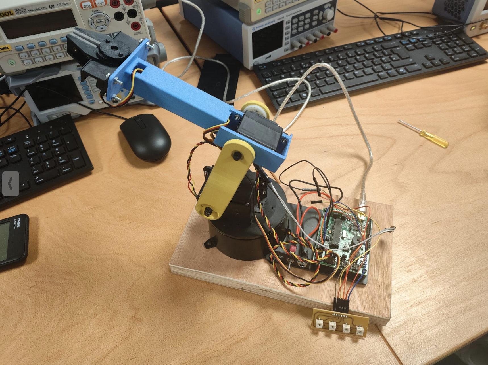

# Robotic manufacturing simulation and physical arm control

**September–October 2026 · RoboDK · ABB IRB 120 · MATLAB · Arduino**

A robotics project combining three industrial manufacturing simulations with kinematics and control of a physical servo robot arm.

[Full portfolio write-up and demonstrations](https://zceeamt.github.io/#robotics)

## Industrial simulations

Each RoboDK station contains an ABB IRB 120, a workpiece, a tool, reference frames, targets and motion programs. Open one station at a time and run `MainProgram` to simulate the operation. The programs use joint, linear and circular motion with approach, retract and clearance paths.

- **Welding:** straight, zigzag and semicircular seams, plus side and end sections; the torch TCP maintains the defined offset from the physical tip.
- **Deburring:** outer edges and circular rim, accounting for a 20 mm cutter radius and a small simulation clearance.
- **Milling:** rounded rectangular and oblong pockets, an open slot and a side circular hole, using 2 mm depth increments, overlapping passes and compensation for a 4 mm cutter radius. The supplied finished-part geometry is shown; stock removal is not animated.

These are offline simulations rather than evidence of physical manufacturing.

## Physical robot arm

The physical arm work used MATLAB forward and inverse kinematics to relate measured link geometry and joint angles to Cartesian gripper positions. Calculated positions were compared with physical measurements.

Arduino control covered three joint servos and a gripper servo, with calibration offsets and three potentiometers providing requested Cartesian coordinates. Serial Monitor output supported debugging and comparison with the mathematical model.

## Evidence and scope

The repository presents the project through its description, physical-arm photograph and simulation clips. The portfolio includes captured RoboDK simulation clips; the physical photo documents a separate laboratory robot.

## Simulation clips

- [Welding](videos/welding.mp4)
- [Deburring](videos/deburring.mp4)
- [Milling excerpt](videos/milling.mp4)

Clips are accelerated recordings from RoboDK. The milling clip is an excerpt rather than the complete machining sequence.
